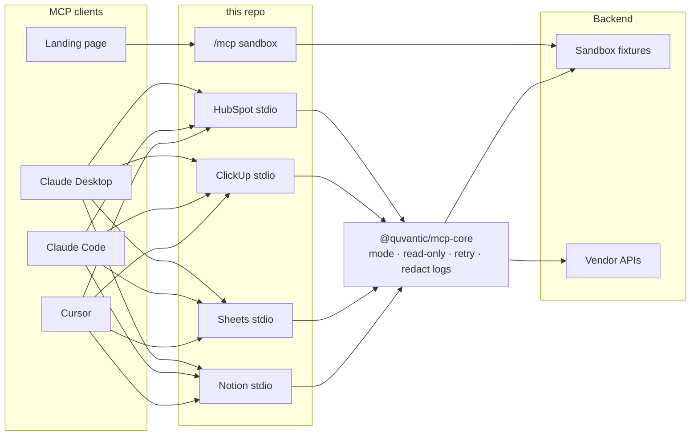

# business-mcp-connectors

[](https://github.com/mustafaautomation/business-mcp-connectors/actions/workflows/ci.yml)
[](LICENSE)

Portfolio demo, not client work. MCP servers for HubSpot, ClickUp, Google Sheets, and Notion, by Mustafa ([mustafaautomation](https://github.com/mustafaautomation)). Live page: [mcp-connectors.quvantic.com](https://mcp-connectors.quvantic.com). Source: [github.com/mustafaautomation/business-mcp-connectors](https://github.com/mustafaautomation/business-mcp-connectors).

Harbor & Co. and the other records are fiction. Sandbox mode needs no accounts. The public `/mcp` endpoint is that sandbox, read-only.


## 60-second quickstart

```bash
git clone https://github.com/mustafaautomation/business-mcp-connectors.git
cd business-mcp-connectors
pnpm install
pnpm build
pnpm demo
```

`pnpm demo` is an in-memory MCP client. It searches won HubSpot deals, lists ClickUp lists, reads a Sheets range, searches Notion, then runs the won-deal workflow on the same fixtures.

Prefer not to clone? The hosted sandbox answers a read immediately:

```bash
curl -s https://mcp-connectors.quvantic.com/api/sandbox \
  -H 'content-type: application/json' \
  -d '{"tool":"hubspot_search_deals","arguments":{"stage":"closedwon"}}'
```

Point a remote MCP client at `https://mcp-connectors.quvantic.com/mcp` (stateless Streamable HTTP, JSON responses, reads only).

## Tools

| Server  | Bin           | Read                                                                                                          | Write                                                                                                               |
| ------- | ------------- | ------------------------------------------------------------------------------------------------------------- | ------------------------------------------------------------------------------------------------------------------- |
| HubSpot | `mcp-hubspot` | `search_contacts`, `get_contact`, `search_companies`, `get_company`, `search_deals`, `get_deal`, `list_notes` | `create_contact`, `update_contact`, `create_company`, `update_company`, `create_deal`, `update_deal`, `create_note` |
| ClickUp | `mcp-clickup` | `list_lists`, `get_list`, `list_tasks`, `get_task`, `list_comments`                                           | `create_task`, `update_task`, `create_comment`                                                                      |
| Sheets  | `mcp-sheets`  | `read_range`, `find_rows`                                                                                     | `append_rows`                                                                                                       |
| Notion  | `mcp-notion`  | `search`, `read_page`, `read_database`, `query_database`                                                      | `create_page`                                                                                                       |

Thirty tools. List results use `items` and `nextCursor` in both modes.

## Architecture



Stdio logs go to stderr so they never touch the protocol stream. `requestJson` retries 429 and 5xx, honors `Retry-After`, and redacts authorization headers, bearer tokens, and token query parameters.

The hosted function is stateless: one JSON-RPC POST, one JSON response, then the invocation ends. That fits a Vercel free-tier function (10 second cap, no long-lived SSE). GET `/mcp` returns a short description instead of holding a stream open.

## Read-only

`MCP_READ_ONLY=true` (also `1` or `yes`) or `--read-only` keeps write tools visible and answers them with `READ_ONLY`. The public `/mcp` server goes further and only registers read tools.

## Live tokens and scopes

Copy `.env.example`. Sandbox is the default. Live mode does not fall back to fixtures.

| Connector | Env                          | Access                                                                                                                                                                                                                                              |
| --------- | ---------------------------- | --------------------------------------------------------------------------------------------------------------------------------------------------------------------------------------------------------------------------------------------------- |
| HubSpot   | `HUBSPOT_ACCESS_TOKEN`       | Private app: `crm.objects.contacts.read`, `crm.objects.contacts.write`, `crm.objects.companies.read`, `crm.objects.companies.write`, `crm.objects.deals.read`, `crm.objects.deals.write`. Note association ids: contact 202, company 190, deal 214. |
| ClickUp   | `CLICKUP_API_TOKEN`          | Personal token. The header is the raw token. `list_lists` also needs `CLICKUP_TEAM_ID` or `CLICKUP_SPACE_ID`.                                                                                                                                       |
| Sheets    | `GOOGLE_SHEETS_ACCESS_TOKEN` | Scope `https://www.googleapis.com/auth/spreadsheets`. `spreadsheets.readonly` can read and find, and cannot append. Set `GOOGLE_SHEETS_SPREADSHEET_ID`.                                                                                             |
| Notion    | `NOTION_API_TOKEN`           | Internal integration with Read content, Update content, and Insert content. Share each page and database with it. Requests send `Notion-Version: 2022-06-28`.                                                                                       |

## Won-deal workflow

`mcp-deal-won-onboarding` finds HubSpot deals in `closedwon`, then for each deal without an `[mcp] Onboarding started` note:

1. Creates four ClickUp tasks: Send kickoff agenda, Provision workspace access, Schedule stakeholder interviews, Deliver week-1 success plan.
2. Appends a row to `Won Deals`.
3. Writes the note, including the task ids.

```bash
node packages/workflow/dist/cli.js
```

## Client config

Replace `ABSOLUTE_PATH` with the repo root. Files: `docs/clients/`.

| Client         | Where it goes                                                                  |
| -------------- | ------------------------------------------------------------------------------ |
| Claude Desktop | `claude_desktop_config.json`. Snippet: `docs/clients/claude-desktop.mcp.json`. |
| Claude Code    | `.mcp.json`. Snippet: `docs/clients/claude-code.mcp.json`.                     |
| Cursor         | `.cursor/mcp.json`. Snippet: `docs/clients/cursor.mcp.json`.                   |

Hosted sandbox, once the site is deployed:

```json
{
  "mcpServers": {
    "quvantic-sandbox": {
      "url": "https://mcp-connectors.quvantic.com/mcp"
    }
  }
}
```

After a real npm publish, a local server can also be `npx -y @quvantic/mcp-hubspot`. These packages are publish-ready and have not been published. Bins: `mcp-hubspot`, `mcp-clickup`, `mcp-sheets`, `mcp-notion`, `mcp-deal-won-onboarding`.

## Scripts

| Command          | What it does                                               |
| ---------------- | ---------------------------------------------------------- |
| `pnpm lint`      | Biome                                                      |
| `pnpm typecheck` | `tsc -b` and the site                                      |
| `pnpm test`      | Vitest, including the hosted HTTP sandbox                  |
| `pnpm build`     | Packages, bins, and the static site                        |
| `pnpm demo`      | The recorded client session                                |
| `pnpm dev:site`  | Landing page on port 44721, with `/mcp` and `/api/sandbox` |

Regenerate the GIF from the repo root with [vhs](https://github.com/charmbracelet/vhs): `pnpm build && vhs docs/demo.tape`.

## Landing page

`site/` is a Vite app. On Vercel, leave the project root as this repository. `vercel.json` builds the packages and the site, publishes `site/dist`, and rewrites `/mcp` to the `api/mcp` function. Add `mcp-connectors.quvantic.com` as the domain. The page needs no secrets. The functions only touch in-memory fixtures.

## FAQ

**Is Harbor & Co. a client?**
No. Portfolio demo, not client work.

**Does the hosted endpoint see my HubSpot account?**
No. `/mcp` and `/api/sandbox` only read the seeded fiction, and they do not accept tokens.

**Can production be read-only?**
Yes. Set `MCP_READ_ONLY=true` or pass `--read-only`.

**Which clients work?**
Claude Desktop, Claude Code, and Cursor over stdio. The hosted sandbox is Streamable HTTP for clients that accept a URL.

**Where do tokens live?**
In the environment of the process you start. Logs redact them. Do not paste tokens into issues.

## Offer

[docs/OFFER.md](docs/OFFER.md) is the Upwork proposal and Fiverr gig: Starter $400, Growth $900, Ops workflow $1,800.

## License

MIT. Copyright 2026 Mustafa. See [LICENSE](LICENSE), [CONTRIBUTING](CONTRIBUTING.md), and [CHANGELOG](CHANGELOG.md).
